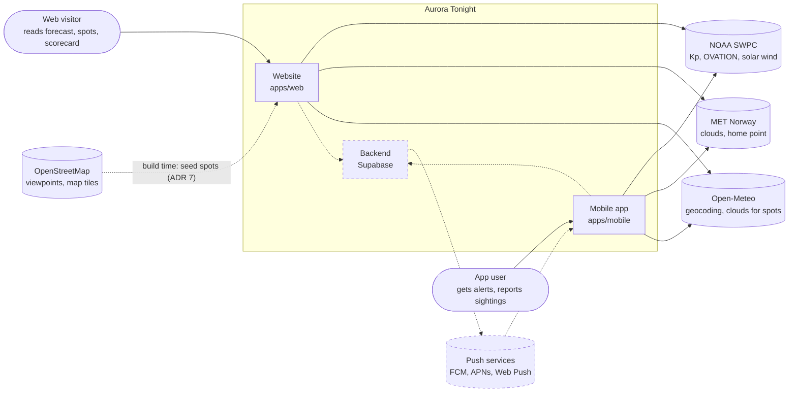
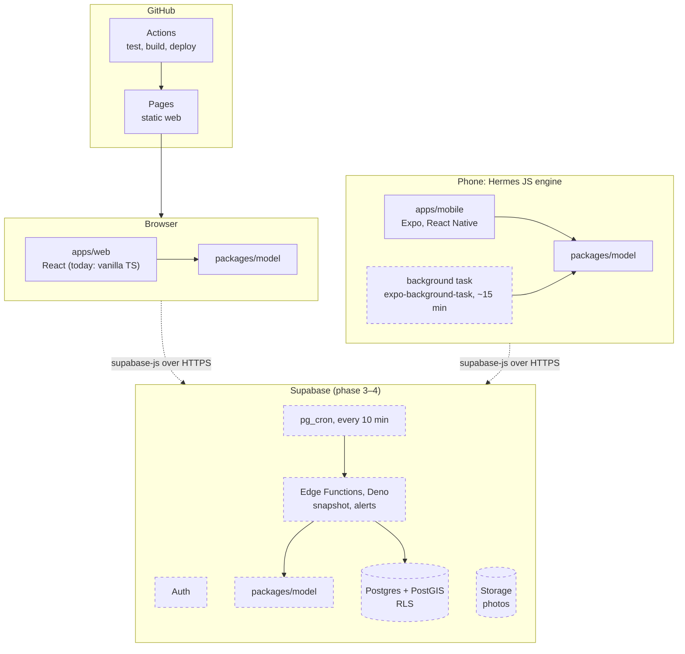
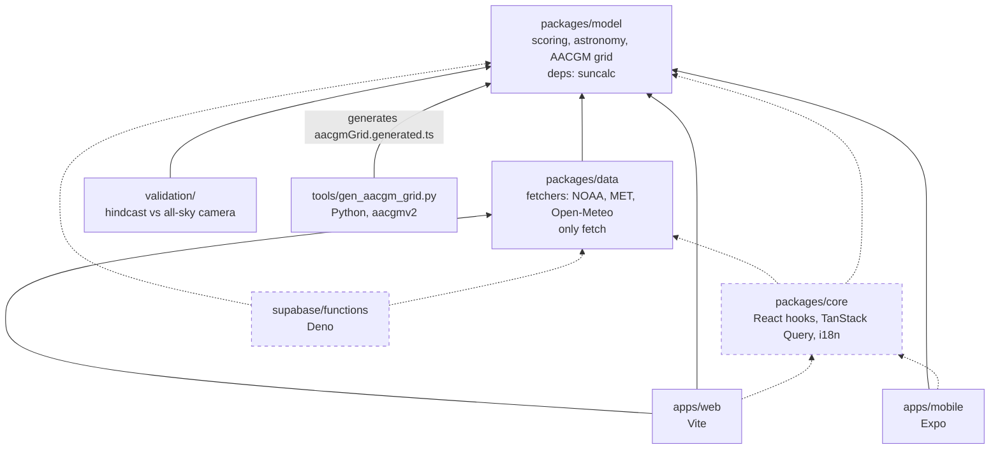
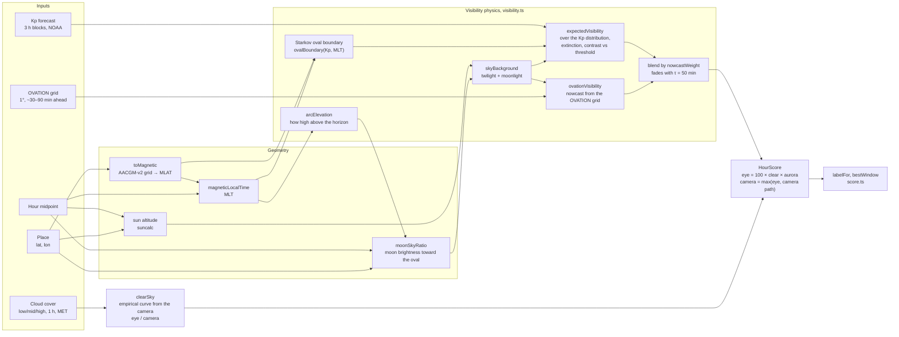
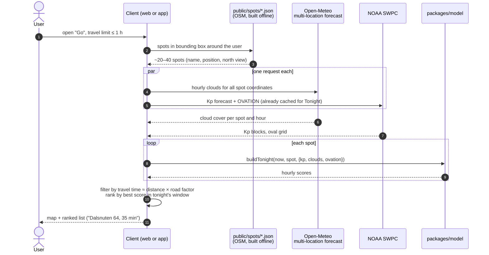
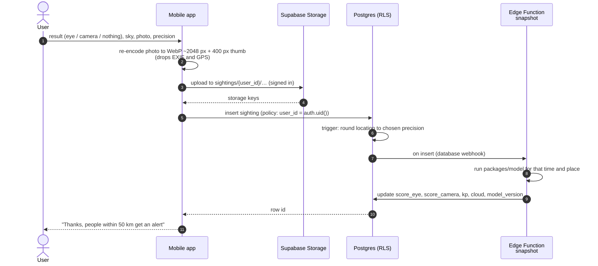
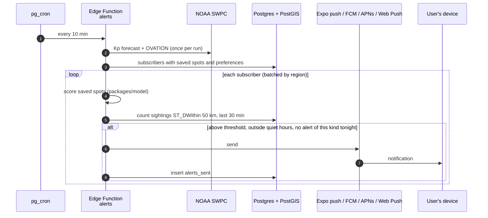
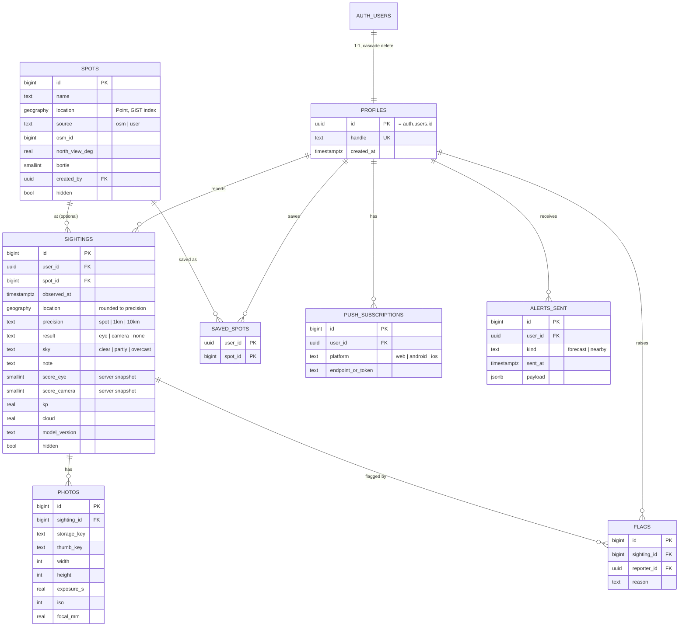
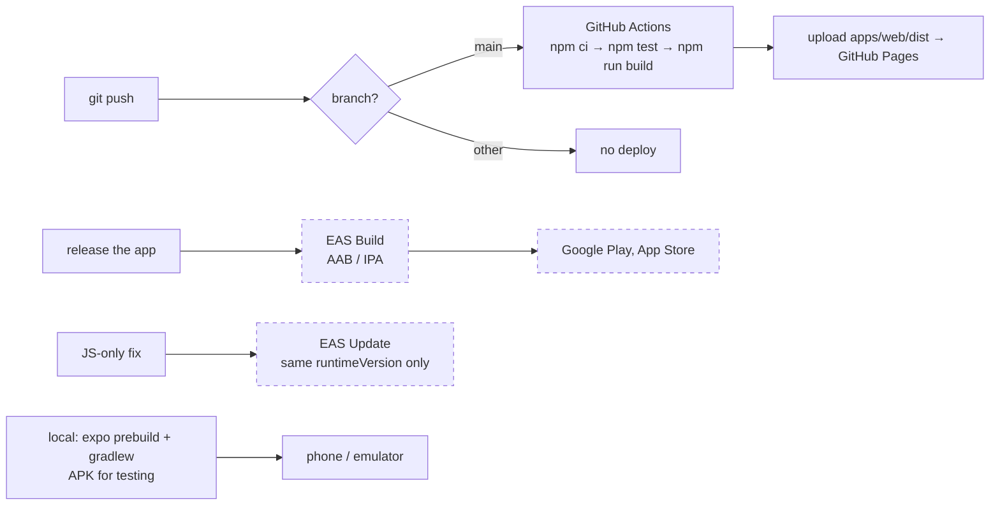
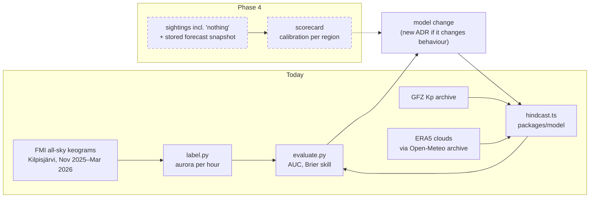

# Architecture

Diagrams of how Aurora Tonight is built and how its parts talk to each other. They are written in
[Mermaid](https://mermaid.js.org/), so GitHub renders them and they change in the same commit as the code.

Legend: **solid** boxes exist today, **dashed** boxes are planned (with the phase from [`spec.md`](spec.md#phases)).
Decisions behind each picture are linked as ADRs ([index](adr/README.md)). Last updated 2026-11-19.

Contents:

1. [System context](#1-system-context)
2. [Where code runs](#2-where-code-runs)
3. [Packages and dependencies](#3-packages-and-dependencies)
4. [How the tonight score is computed](#4-how-the-tonight-score-is-computed)
5. [Where to go (phase 1)](#5-where-to-go-phase-1)
6. [Reporting a sighting (phase 3)](#6-reporting-a-sighting-phase-3)
7. [Alerts (phase 4)](#7-alerts-phase-4)
8. [Database schema (phase 3)](#8-database-schema-phase-3)
9. [Build and release](#9-build-and-release)
10. [Validation loop](#10-validation-loop)

---

## 1. System context

Who uses the system and which outside services it depends on.

All forecast data is fetched directly by the client (CORS is allowed by every source), so the forecast keeps working
without a backend ([ADR 3](adr/0003-static-hosting-and-web-first.md)). The backend only holds what users create.

## 2. Where code runs

The same TypeScript model runs in four places ([ADR 4](adr/0004-one-typescript-model-for-all-runtimes.md)).

## 3. Packages and dependencies

npm workspaces ([ADR 13](adr/0013-react-and-react-native-via-expo.md)). Arrows point from the user of a package to
the package. The rule that keeps sharing possible: nothing below `apps/` may import `react-dom` or `react-native`,
and `packages/model` may not touch any runtime API at all (its `tsconfig` has no DOM or Node types).

## 4. How the tonight score is computed

One hour of `buildTonight()` in `packages/model/src/night.ts`. Inputs arrive at different resolutions (1 min, 1 h,
3 h, 1° grid); the model evaluates everything at the middle of each night hour. A missing input lowers confidence
instead of failing (`missing[]`).

Validated against the Kilpisjärvi all-sky camera; see [section 10](#10-validation-loop) and `validation/README.md`.

## 5. Where to go (phase 1)

Runs entirely in the client ([ADR 6](adr/0006-where-to-go-computed-in-the-client.md),
[ADR 7](adr/0007-spots-seeded-from-openstreetmap.md)). The expensive part, the cloud forecast for many points, is one
request.

## 6. Reporting a sighting (phase 3)

The privacy rules ([ADR 10](adr/0010-location-and-photo-privacy.md)) and the trusted forecast snapshot
([ADR 9](adr/0009-sightings-as-observations-with-forecast-snapshot.md)) are enforced on the server, not only in the UI.

## 7. Alerts (phase 4)

([ADR 11](adr/0011-server-side-alerts.md)). Forecast alerts and report alerts share one job, one cooldown and one log.

## 8. Database schema (phase 3)

Sketch from [ADR 9](adr/0009-sightings-as-observations-with-forecast-snapshot.md); the real schema will live in
`supabase/migrations/`. Every table has RLS: public read of rows that are not hidden, writes only by the owner.

## 9. Build and release

`android/` and `ios/` in `apps/mobile` are generated by `expo prebuild` from `app.json` and are not committed.

## 10. Validation loop

How the model is checked against reality today, and how user reports will join in phase 4.

Current numbers (2026-11-18): clear-sky ranking AUC 0.97; overall AUC 0.79, Brier skill +0.22 after the empirical
cloud curve. Reporters choose promising nights, so report-based calibration is biased; the camera stays the
unbiased reference.
