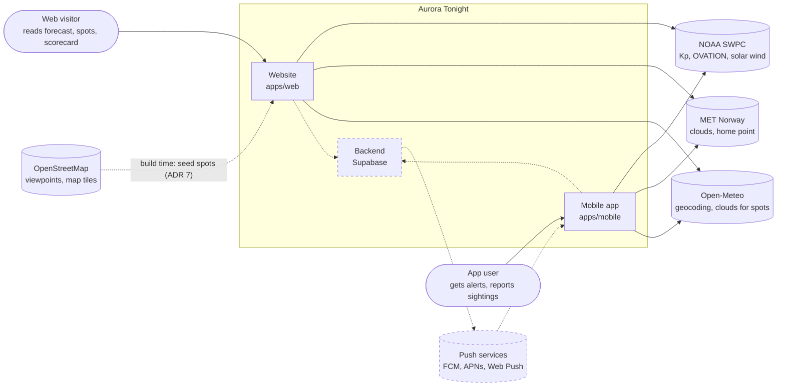

# System context

Part of the [architecture diagrams](../architecture.md). Mermaid flowchart, rendered in place on the
repository page. Legend: **solid** = exists today, **dashed** = planned.

Who uses the system and which outside services it depends on.

All forecast data is fetched directly by the client (CORS is allowed by every source), so the forecast keeps working
without a backend ([ADR 3](../adr/0003-static-hosting-and-web-first.md)). The backend only holds what users create.

---

[← All diagrams](../architecture.md)
