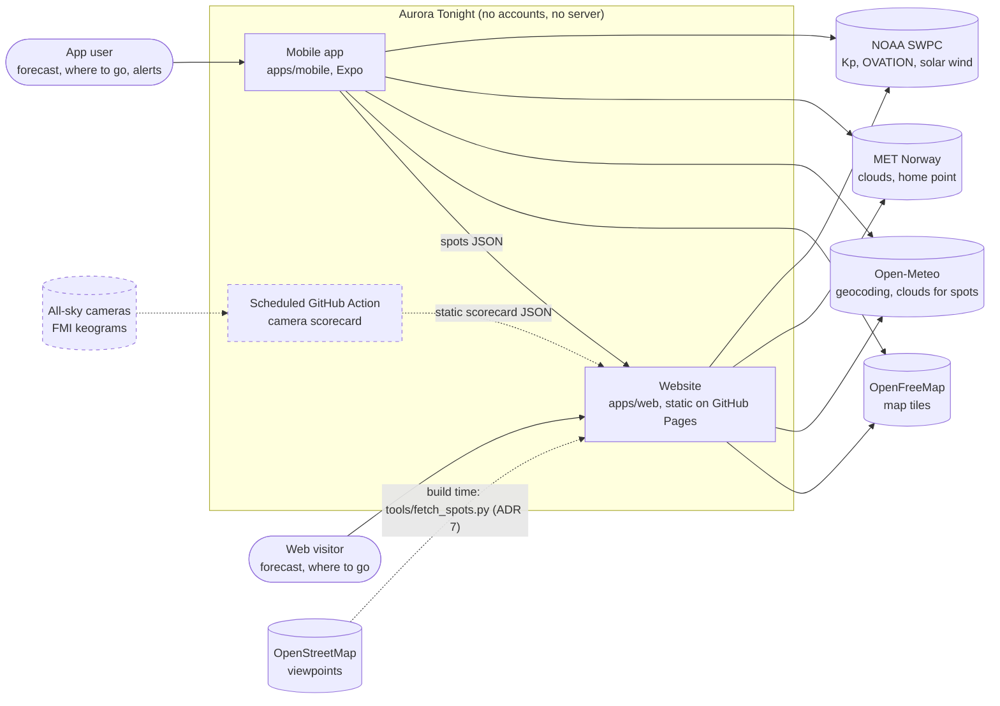

# System context

Part of the [architecture diagrams](../architecture.md). Mermaid flowchart, rendered in place on the
repository page. Legend: **solid** = exists today, **dashed** = planned.

Who uses the system and which outside services it depends on. There is no backend: the website and the app talk
only to public data sources ([ADR 3](../adr/0003-static-hosting-and-web-first.md),
[ADR 14](../adr/0014-no-accounts-no-backend.md)).

All forecast data is fetched directly by the client (every source allows CORS or, in the app, plain HTTPS), so
nothing personal is stored anywhere but on the user's own device.

---

[← All diagrams](../architecture.md)
