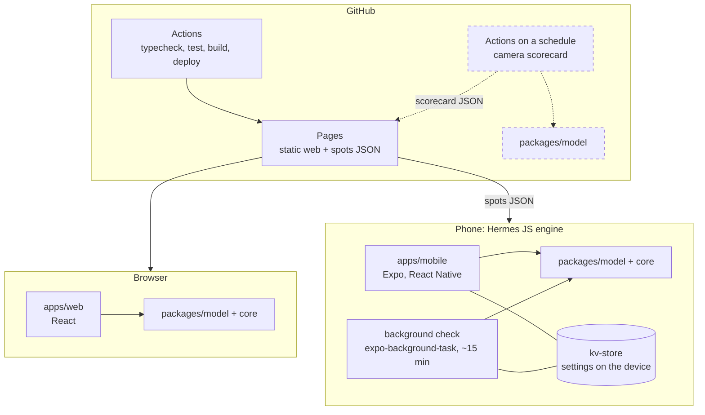

# Where code runs

Part of the [architecture diagrams](../architecture.md). Mermaid flowchart, rendered in place on the
repository page. Legend: **solid** = exists today, **dashed** = planned.

The same TypeScript model runs in every place that needs a score
([ADR 4](../adr/0004-one-typescript-model-for-all-runtimes.md)). No server of our own
([ADR 14](../adr/0014-no-accounts-no-backend.md)).

---

[← All diagrams](../architecture.md)
