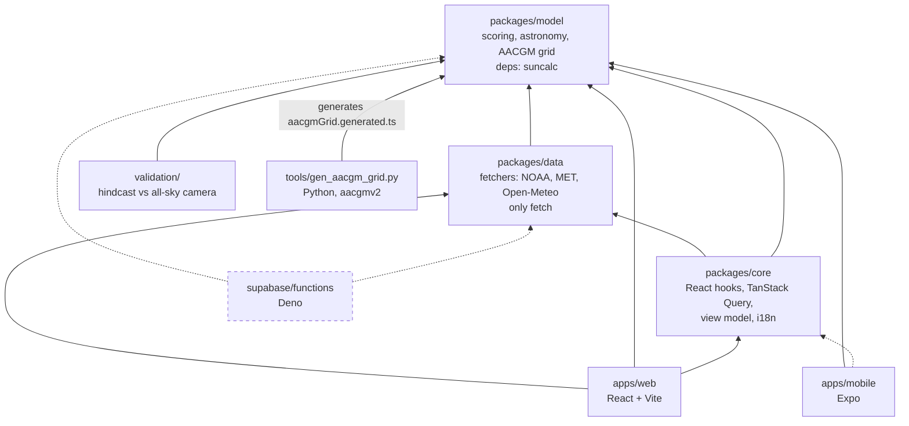

# Packages and dependencies

Part of the [architecture diagrams](../architecture.md). Mermaid flowchart, rendered in place on the
repository page. Legend: **solid** = exists today, **dashed** = planned.

npm workspaces ([ADR 13](../adr/0013-react-and-react-native-via-expo.md)). Arrows point from the user of a package to
the package. The rule that keeps sharing possible: nothing below `apps/` may import `react-dom` or `react-native`,
and `packages/model` may not touch any runtime API at all (its `tsconfig` has no DOM or Node types).

---

[← All diagrams](../architecture.md)
