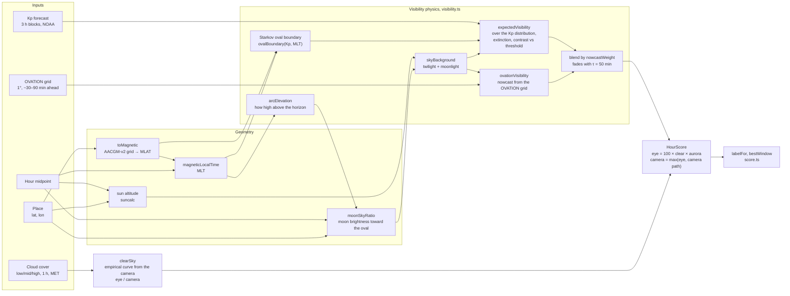

# How the tonight score is computed

Part of the [architecture diagrams](../architecture.md). Mermaid flowchart, rendered in place on the
repository page. Legend: **solid** = exists today, **dashed** = planned.

One hour of `buildTonight()` in `packages/model/src/night.ts`. Inputs arrive at different resolutions (1 min, 1 h,
3 h, 1° grid); the model evaluates everything at the middle of each night hour. A missing input lowers confidence
instead of failing (`missing[]`).

Validated against the Kilpisjärvi all-sky camera; see [the validation loop](09-validation-loop.md) and `validation/README.md`.

---

[← All diagrams](../architecture.md)
