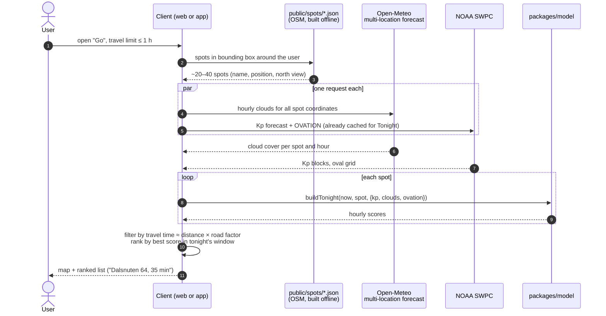

# Where to go (phase 1)

Part of the [architecture diagrams](../architecture.md). Mermaid sequence diagram, rendered in place on the
repository page. Legend: **solid** = exists today, **dashed** = planned.

Runs entirely in the client ([ADR 6](../adr/0006-where-to-go-computed-in-the-client.md),
[ADR 7](../adr/0007-spots-seeded-from-openstreetmap.md)). The expensive part, the cloud forecast for many points, is one
request.

---

[← All diagrams](../architecture.md)
