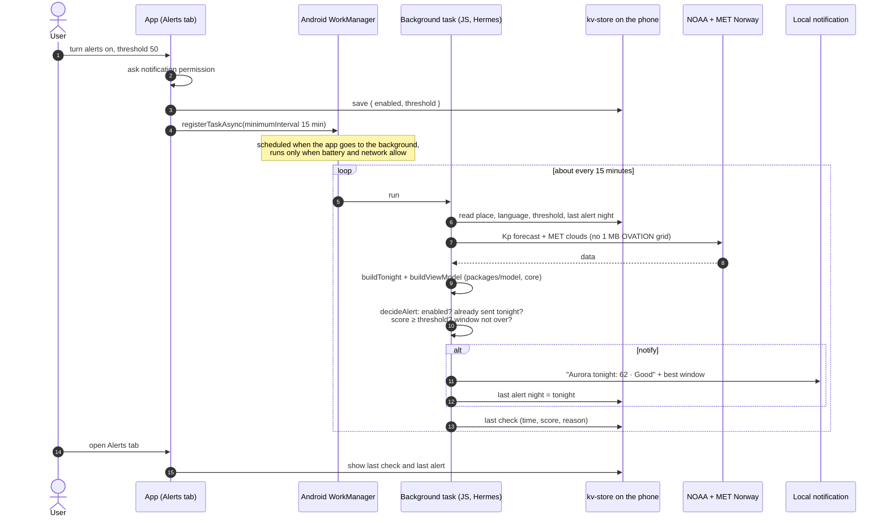

# Alerts on the device

Part of the [architecture diagrams](../architecture.md). Mermaid sequence diagram, rendered in place on the
repository page. Legend: **solid** = exists today, **dashed** = planned.

The app's alerts need no server ([ADR 14](../adr/0014-no-accounts-no-backend.md)). Code:
`apps/mobile/src/background/task.ts` (fetch, compute, notify) and `decideAlert` in
`packages/core/src/alerts.ts` (unit-tested). Built and emulator-tested 2026-11-19.

Testing on an emulator: `apps/mobile/README.md` (force the WorkManager job with `cmd jobscheduler run`).

---

[← All diagrams](../architecture.md)
