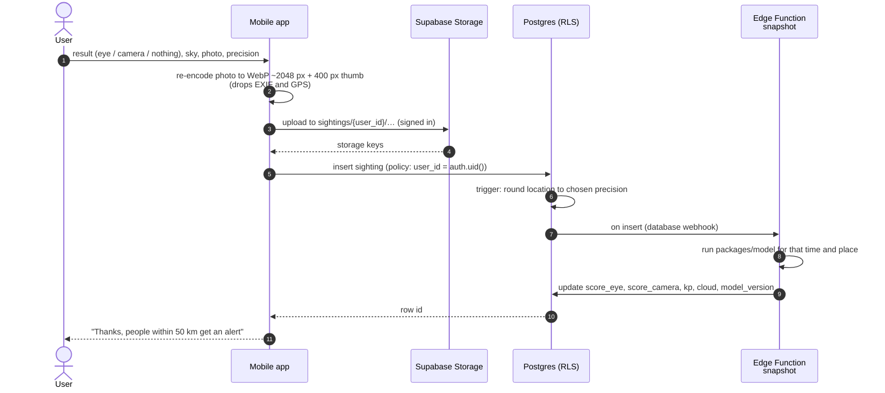

# Reporting a sighting (phase 3)

Part of the [architecture diagrams](../architecture.md). Mermaid sequence diagram, rendered in place on the
repository page. Legend: **solid** = exists today, **dashed** = planned.

The privacy rules ([ADR 10](../adr/0010-location-and-photo-privacy.md)) and the trusted forecast snapshot
([ADR 9](../adr/0009-sightings-as-observations-with-forecast-snapshot.md)) are enforced on the server, not only in the UI.

---

[← All diagrams](../architecture.md)
