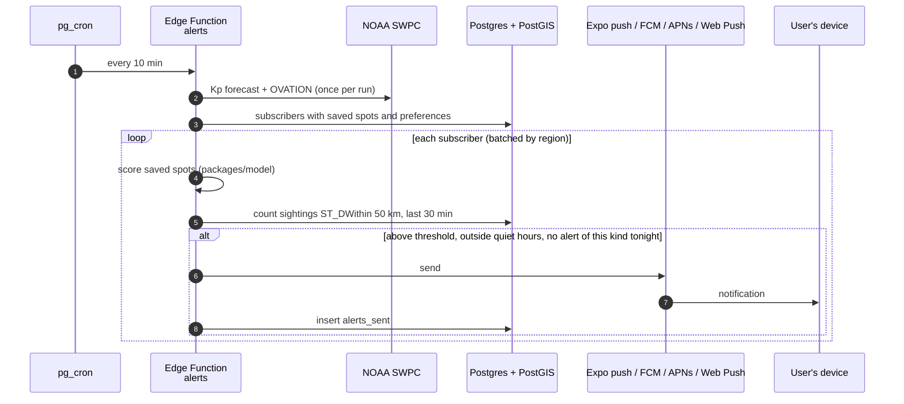

# Alerts (phase 4)

Part of the [architecture diagrams](../architecture.md). Mermaid sequence diagram, rendered in place on the
repository page. Legend: **solid** = exists today, **dashed** = planned.

([ADR 11](../adr/0011-server-side-alerts.md)). Forecast alerts and report alerts share one job, one cooldown and one log.

---

[← All diagrams](../architecture.md)
