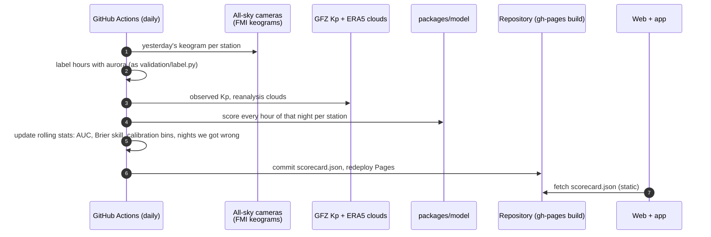

# Camera scorecard (planned, phase 3)

Part of the [architecture diagrams](../architecture.md). Mermaid sequence diagram, rendered in place on the
repository page. Legend: **solid** = exists today, **dashed** = planned.

How accurate is the forecast, without users or a server ([ADR 14](../adr/0014-no-accounts-no-backend.md)): a
scheduled GitHub Action repeats what `validation/` does by hand today and publishes the result as static JSON.
Only the plan exists; which cameras can be used, and on which terms, is an open question in `spec.md`.

Cameras cover northern Norway and Finland; southern Norway stays a blind spot, and the page has to say so.

---

[← All diagrams](../architecture.md)
