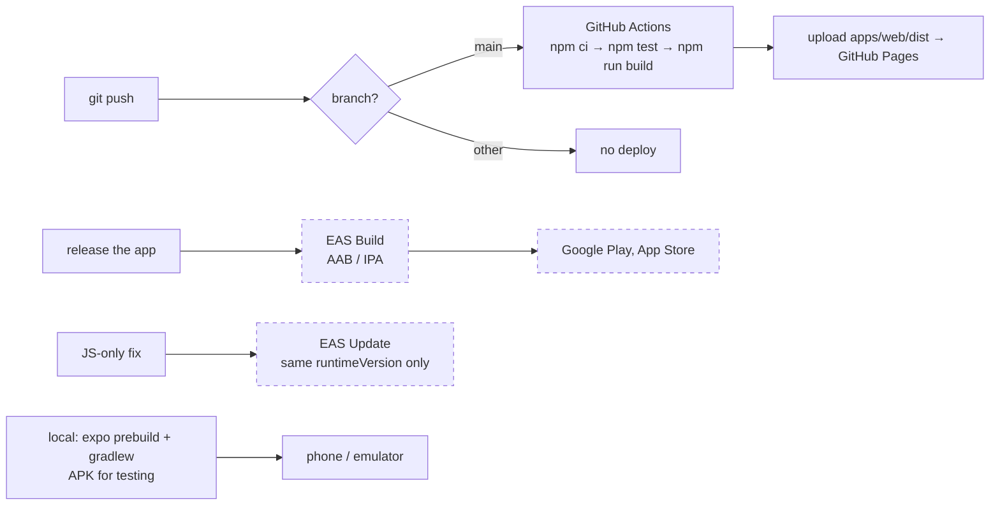

# Build and release

Part of the [architecture diagrams](../architecture.md). Mermaid flowchart, rendered in place on the
repository page. Legend: **solid** = exists today, **dashed** = planned.

`android/` and `ios/` in `apps/mobile` are generated by `expo prebuild` from `app.json` and are not committed.

---

[← All diagrams](../architecture.md)
