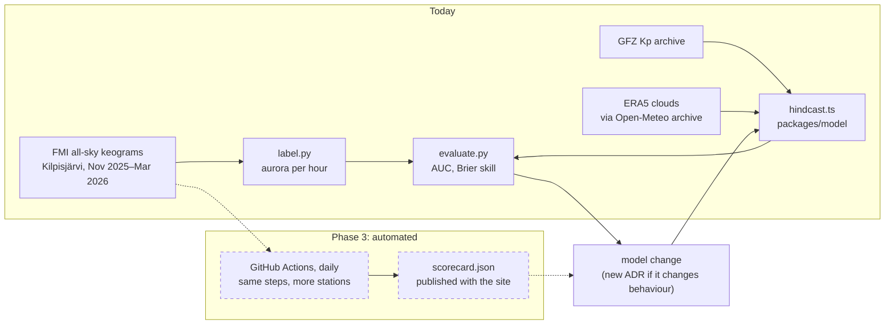

# Validation loop

Part of the [architecture diagrams](../architecture.md). Mermaid flowchart, rendered in place on the
repository page. Legend: **solid** = exists today, **dashed** = planned.

How the model is checked against reality today, and how the same check becomes an automatic scorecard in phase 3.

Current numbers (2026-11-18): clear-sky ranking AUC 0.97; overall AUC 0.79, Brier skill +0.22 after the empirical
cloud curve. Cameras are an unbiased reference (they record every night, not only the promising ones) but cover
only the north; southern Norway stays unvalidated. See [the camera scorecard](07-camera-scorecard.md).

---

[← All diagrams](../architecture.md)
