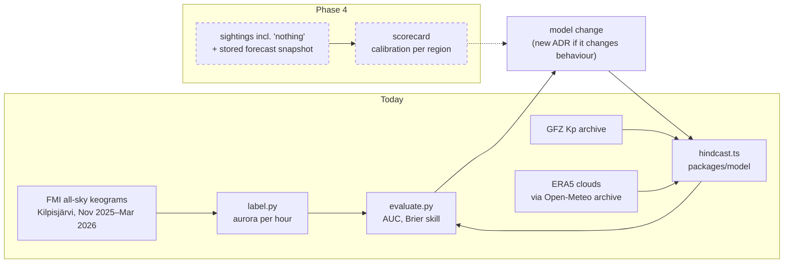

# Validation loop

Part of the [architecture diagrams](../architecture.md). Mermaid flowchart, rendered in place on the
repository page. Legend: **solid** = exists today, **dashed** = planned.

How the model is checked against reality today, and how user reports will join in phase 4.

Current numbers (2026-11-18): clear-sky ranking AUC 0.97; overall AUC 0.79, Brier skill +0.22 after the empirical
cloud curve. Reporters choose promising nights, so report-based calibration is biased; the camera stays the
unbiased reference.

---

[← All diagrams](../architecture.md)
