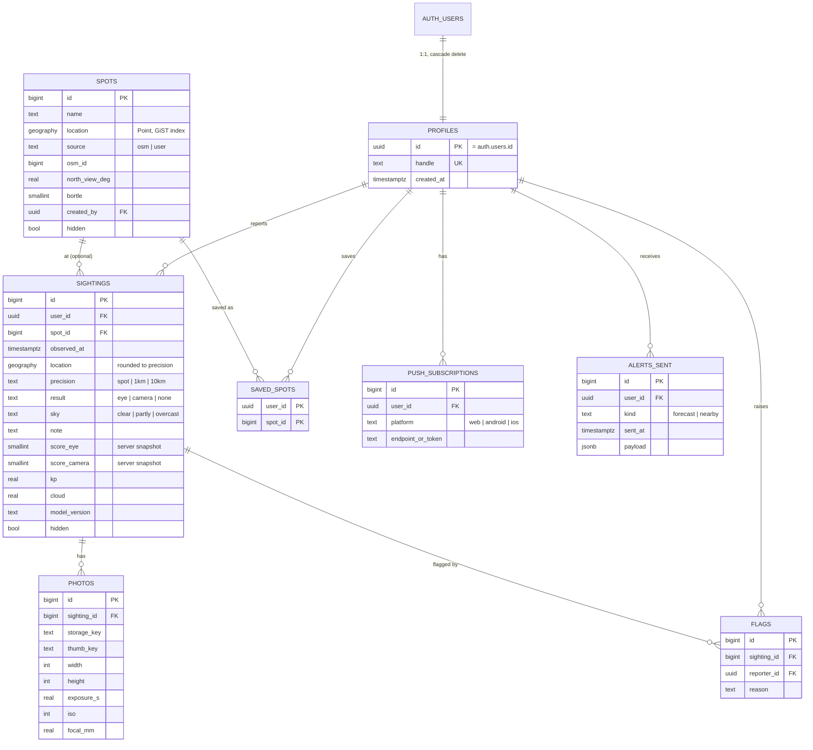

# Database schema (phase 3)

> **Archived 2026-11-19.** Not built: accounts and the backend were dropped in [ADR 14](../../adr/0014-no-accounts-no-backend.md). Kept as the design that was considered.

Part of the [architecture diagrams](../../architecture.md). Mermaid ER diagram, rendered in place on the
repository page. Legend: **solid** = exists today, **dashed** = planned.

Sketch from [ADR 9](../../adr/0009-sightings-as-observations-with-forecast-snapshot.md); the real schema will live in
`supabase/migrations/`. Every table has RLS: public read of rows that are not hidden, writes only by the owner.

---

[← All diagrams](../../architecture.md)
