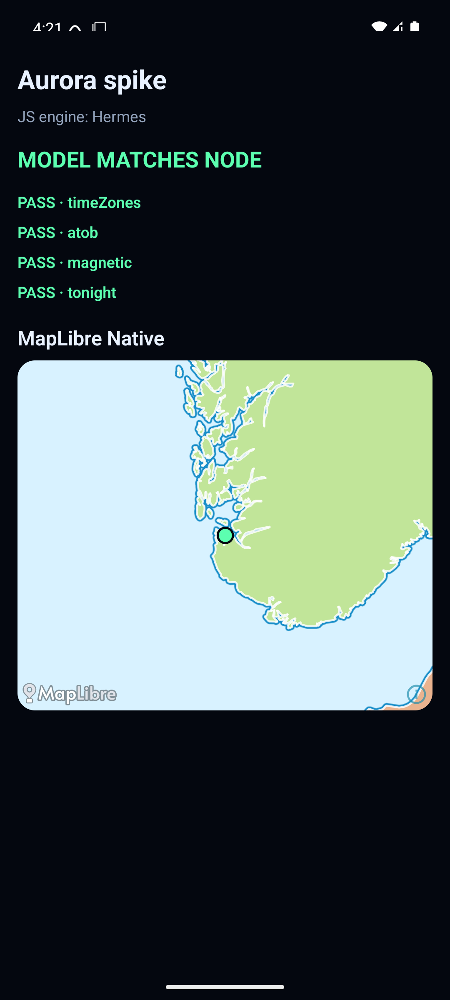

# Spike: shared model on Hermes, MapLibre Native in Expo

- Date: 2026-11-19
- Related: [ADR 4](../adr/0004-one-typescript-model-for-all-runtimes.md), [ADR 13](../adr/0013-react-and-react-native-via-expo.md)
- Result: **both risks cleared** (on the emulator; still to repeat on a real phone)

## Questions

1. Does `packages/model` give the same results on Hermes (React Native's JS engine) as on Node? The risk was
   `Intl.DateTimeFormat` with `timeZone` and `formatToParts` (`time.ts`), which needed a shim in QuickJS, and the
   `atob` global used to decode the AACGM grid.
2. Does `@maplibre/maplibre-react-native` build and render with the current Expo SDK through its config plugin?

## Setup

- `apps/mobile`: Expo SDK 58, React Native 0.88.1, React 19.3, new architecture and Hermes on (defaults),
  `@maplibre/maplibre-react-native` 11.5.1 as a config plugin in `app.json`.
- `src/spike/checks.ts` runs the model on fixed, synthetic inputs (no network): local time parts for 4 instants ×
  4 zones (including both sides of the EU DST switch on 2026-03-29), `atob`, `toMagnetic` for Stavanger, and the full
  `buildTonight` for Stavanger with synthetic Kp and clouds. Numbers are rounded to 6 decimals.
- `scripts/gen-expected.ts` runs the same function in Node (full ICU) and writes `src/spike/expected.json`;
  `npm run spike:expected -w @aurora/mobile`.
- The app compares leaf by leaf and shows PASS/FAIL per section, plus a MapLibre map with a marker.
- Built locally as a **release** APK (JS compiled to Hermes bytecode and bundled, as in production):
  `npx expo prebuild --platform android`, then `./gradlew assembleRelease -PreactNativeArchitectures=x86_64`
  (4 min 16 s cold, 34 MB APK for one ABI). Installed on the emulator `aurora35` (Android 15 / API 35, x86_64).

## Result

- JS engine reported as Hermes (`globalThis.HermesInternal`).
- `timeZones`, `atob`, `magnetic`, `tonight`: all **PASS**, identical to Node to 6 decimals. No shim needed on
  Hermes, unlike QuickJS.
- MapLibre Native renders the demo style and a React Native view as a marker. Logcat shows only "Could not find
  generated setter" warnings for MapLibre view managers (React Native falls back to reflection; harmless, worth
  rechecking after library upgrades).
- The workspace setup works with Metro without extra config: `@aurora/model` resolves through the package
  `exports` (`"./*": "./src/*.ts"`) and is compiled from source.

## Limits and follow-ups

- Emulator only. Repeat on a real Android phone (ARM64, a different ICU build) before relying on it: install the
  APK built for all ABIs, or run `npm run android -w @aurora/mobile` with the phone on USB.
- iOS not tested (needs EAS Build and an Apple Developer account); Hermes on iOS uses a different Intl backend.
- The spike screen is temporary. When phase 2 starts, `App.tsx` gives way to Expo Router, and `checks.ts` should
  become an automated test (for example a Maestro or Detox run in CI) so a Hermes or SDK upgrade cannot silently
  change scores.
